# iCal4j Connector

iCal4j Connector is a tool that helps you manage iCalendar and vCard collections.

## Overview

The connector includes multiple interfaces for interacting with collections of iCalendar and vCard data. A
command line interface allows you to create, query and manipulate collections of data and output to mutliple
formats for tool chaining support. The REST API uses the same underlying command pattern for the CLI to expose 
similar functions to HTTP-enabled clients. And the Java API provides support for the implementation of pluggable
backends for integration with both standard and customized data sources using the same interface.

## Command-line Interface

TBD.

## REST API

TBD.

## Java API

The Java API is built around two interfaces. An `ObjectStore` represents a backend that holds
collections and is organised into one or more workspaces. An `ObjectCollection` represents a single
collection of iCalendar or vCard objects, identified by their `UID`, that can be listed, fetched, added to
and removed from. `CalendarCollection` and `CardCollection` refine the collection interface with
calendar and card specific operations such as `merge()` and `export()`.

Backends are implemented as separate modules that share the `ical4j-connector-api` dependency, so
application code written against the interfaces works with any of them.

| Backend                                  | Module                     | Store classes                              |
|------------------------------------------|----------------------------|--------------------------------------------|
| [Local filesystem](local.md)             | `ical4j-connector-api`     | `LocalCalendarStore`, `LocalCardStore`     |
| [CalDAV / CardDAV](dav.md)               | `ical4j-connector-dav`     | `CalDavCalendarStore`, `CardDavStore`      |
| [Google Calendar](google.md)             | `ical4j-connector-google`  | `GoogleCalendarStore`                      |
| [Microsoft Graph (Outlook)](msgraph.md)  | `ical4j-connector-msgraph` | `MSGraphCalendarStore`                     |

The hosted backends (Google Calendar and Microsoft Graph) take a pre-authenticated API client in their
constructor and leave authentication to the caller. See the individual pages for setup and usage.

## Download

TBD.

## References

* [CalDAV Home](http://caldav.calconnect.org/)
* [RFC4791](http://www.ietf.org/rfc/rfc4791.txt) - Calendaring Extensions to WebDAV (CalDAV)
* [CardDAV Wiki](http://www.vcarddav.org/wiki)
* [draft-ietf-vcarddav-carddav-01](http://tools.ietf.org/html/draft-ietf-vcarddav-carddav-01) - vCard Extensions to WebDAV (CardDAV)
* [caldav4j](http://code.google.com/p/caldav4j/)
* [Comparison of CalDAV and CardDAV implementations](https://en.wikipedia.org/wiki/Comparison_of_CalDAV_and_CardDAV_implementations)
